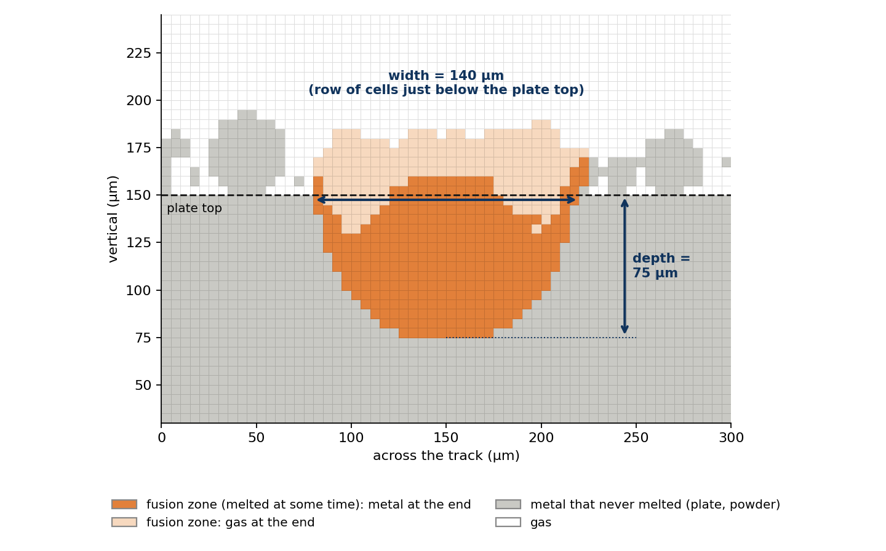

# The metallographic mode of `simtopc measure`

## What "metallographic" means

In the laboratory, a single track is measured by metallography: the sample
is cut across the track, the cut is polished and etched, and the fusion zone
(the metal that melted and solidified again) shows under the microscope with
a different microstructure from the plate around it. The width and the depth
of the track are read on that image, taking the original surface of the
plate as the reference: the width is the width of the fusion zone at the
plate surface, and the depth is how far the fusion zone goes into the plate
(see, for example, Dilip et al. 2017).

The metallographic mode (`geometry_mode: metallographic`) measures a
simulated track in the same way, so that its numbers can be set next to
those of a micrograph.

## How SimToPC does it

Each cross-section is one layer of cells across the track, taken at the
final time of the simulation. Two fields decide what each cell is:

- `meltHistory > 0`: the cell melted at some time. These cells are the
  **fusion zone**, the equivalent of what the etching reveals.
- `alpha.metal >= 0.5`: the cell is metal at the final time.

The plate top is given by the user (`substrate_top`); it must lie on a face
between two rows of cells.

*A cross-section of `test_case_3` of `examples/measure_metallographic`
(1.0 m/s, 5 µm cells), drawn from the cells that SimToPC reads.*

- **Width.** The extent across the track of the fusion zone in the row of
  cells just below the plate top. If an edge cell of that extent is not
  metal at the final time (the surface of the bead sank into the plate
  there), the width is taken one row lower, and at most
  `width_max_rows_down` rows lower (default 2). Beyond that the width of the
  section is not measured.
- **Depth.** From the plate top to the bottom of the lowest cell that melted
  and is metal at the final time.
- **Height.** From the plate top to the top of the highest cell that melted
  and is metal. It is negative for a depression below the plate top.
- **Fill.** The metal fraction of the fusion zone at and below the plate
  top. It is a control of the section (a low value means that much of the
  melted plate ended as gas), not a filter.
- **Centreline surface.** The height of the metal on the centreline of the
  track, from the plate top.

The sections are measured one per cell along the track, and the means are
taken over a window of the track. The window is either given by the user or
found from the steady part of the tracks, one window per scan speed (see
"Measurement modes" in the main [README](../README.md)).

## Differences from the default mode

| | Default (`single_track`) | `metallographic` |
|---|---|---|
| Melt pool | the solidified material point cloud (`alpha.material`, `solidificationTime`) | the cells with `meltHistory > 0` |
| Reference for the lengths | the melt pool itself (see the figure of the main README) | the plate top given by the user |
| Data read | points extracted with pvpython | the cell values of the last time, read directly |
| Axes | the case is adapted to the SimToPC convention | the native axes of the case (`axes`) |
| Solvers | laserMeltFoam, laserbeamFoam | laserbeamFoam only |

The default mode is the one of the SimToPC paper, and it is not changed by
this mode.

## When to use it

- To compare with widths and depths measured on micrographs of single tracks
  on a plate.
- When the powder above the plate makes the material cloud of the default
  mode ambiguous.

## Requirements and limits

- `laserbeamFoam` cases only. The mode needs the field `meltHistory`, which
  `laserMeltFoam` does not write; those cases are rejected with an error.
- Uniform cubic cells (graded meshes are rejected).
- ASCII fields in the last time directory, reconstructed.
- A flat plate with its top on a cell face.

## Example

`examples/measure_metallographic`: four `laserbeamFoam` single tracks, with
their expected results.

## Reference

Dilip, J.J.S., Zhang, S., Teng, C. et al. Influence of processing parameters
on the evolution of melt pool, porosity, and microstructures in Ti-6Al-4V
alloy parts fabricated by selective laser melting. *Progress in Additive
Manufacturing* 2, 157–167 (2017).
